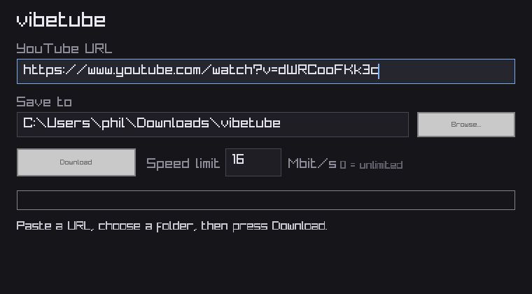

# vibetube

A tiny native Windows GUI for turning a YouTube link into a 160 kbps MP3 — with a
download speed cap, so a big batch of downloads doesn't get your connection
flagged for abuse.



vibetube is a single ~1.2 MB executable written in **Odin**, drawing its own UI
with **raylib/raygui**. There is no Electron, no .NET runtime, no Python, and no
bundled browser. It drives the `yt-dlp` and `ffmpeg` you already have on `PATH`,
and does the filename sanitising itself.

---

## Features

- **One field, one button.** Paste a URL, press Download.
- **Native folder picker** for the output directory, remembered between runs.
- **Speed limit** in Mbit/s (default **16**), passed to yt-dlp as `--limit-rate`.
- **Deterministic filenames**: `<channel>_<title>_160k.mp3`, pure ASCII, only
  `[A-Za-z0-9_-]` plus the extension.
- **Live progress** parsed from yt-dlp's output, plus its error text when
  something fails.
- **No console window** flashing behind the app while it downloads.
- **Custom icon** in the title bar, taskbar, Explorer and pinned shortcuts.
- **Self-contained config** in `%LOCALAPPDATA%\vibetube\config.ini`.

---

## Requirements

**To run:**

| Requirement | Notes |
|---|---|
| Windows 10 or 11, x64 | Uses `CREATE_NO_WINDOW`, the COM folder picker and known-folder APIs |
| [`yt-dlp`](https://github.com/yt-dlp/yt-dlp) on `PATH` | Any recent build; the app parses its `--print` and `--progress` output |
| [`ffmpeg`](https://ffmpeg.org/) on `PATH` | yt-dlp shells out to it for the MP3 transcode |

Verify both before blaming the app:

```bat
yt-dlp --version
ffmpeg -version
```

**To build:**

- [Odin](https://odin-lang.org/) with the bundled `vendor:raylib` (v6.2 or newer)
- Windows, because the build embeds a `.rc` resource and links a Windows subsystem

---

## Quick start (prebuilt)

1. Put `vibetube.exe` anywhere you like — it is self-contained.
2. Make sure `yt-dlp` and `ffmpeg` resolve on `PATH`.
3. Run it, paste a URL, press **Download**.

---

## Build from source

```bat
build.bat         :: bin\vibetube.exe       shipped app, no console window
build.bat dev     :: bin\vibetube-dev.exe   console build, for the dev flags
```

Both flavours embed the icon resource and are otherwise identical. The console
build exists because `--selftest` and `--demo` print to a terminal, which a
windowed build has no way to do.

Artwork is already committed. Only regenerate it if you change the mark:

```bat
python tools\make_icon.py     :: needs Pillow; rewrites assets\*.png and vibetube.ico
```

---

## Using it

| Control | Behaviour |
|---|---|
| **YouTube URL** | Paste with `Ctrl+V` or type. `Enter` starts the download. |
| **Save to** | Where the MP3 lands. **Browse…** opens the native folder picker. |
| **Speed limit** | Mbit/s. `16` ≈ 2 MB/s. `0` = unlimited. |
| **Download** | Starts the job; disabled while a download is running. |
| **Progress bar** | Percentage parsed from yt-dlp. `100%` on success. |
| **Status line** | Live progress, then `Saved: <filename>` in green or the error in red. |

Keyboard: `Tab` cycles URL → Save to → Speed limit, `Esc` drops focus, `Enter`
downloads from any focused field. Closing the window kills a running download
and any child `yt-dlp`/`ffmpeg` process.

---

## Filename rules

`<channel>_<title>_160k.mp3` where both parts are sanitised to:

- **ASCII letters, digits, `-` and `_` only.** Everything else — spaces,
  `&`, quotes, `|`, emoji, CJK — collapses to a single `_`.
- Runs collapse; leading and trailing `_` are trimmed.
- Common Latin accents transliterate (`Café` → `Cafe`, `ß` → `ss`, `Ø` → `O`).
  Scripts with no Latin equivalent are dropped.
- Capped at **180 bytes** including `_160k.mp3`.
- If nothing survives, the name is `unknown_160k.mp3`.

Worked example, from this project's own test fixture:

```
channel:  Rock & Roll Hall of Fame
title:    2021 Remaster "While My Guitar Gently Weeps" Prince, Tom Petty & More | Rock Hall 2004 Induction

→ Rock_Roll_Hall_of_Fame_2021_Remaster_While_My_Guitar_Gently_Weeps_Prince_Tom_Petty_More_Rock_Hall_2004_Induction_160k.mp3
```

---

## Speed limit

Set in **Mbit/s**, default **16**, persisted in the config.

There is a unit trap here worth knowing: yt-dlp's `M` suffix means **mebibytes**,
so `--limit-rate 16M` is ~134 Mbit/s — 8× faster than intended and quiet about
it. vibetube converts to raw bytes itself: 16 Mbit/s → `--limit-rate 2000000`.

`--limit-rate` is an **average** cap applied per stream, not a traffic shaper.
Expect a brief overshoot at the start of a file.

---

## Configuration

`%LOCALAPPDATA%\vibetube\config.ini`, created on first launch:

```ini
; vibetube configuration - created automatically, safe to edit by hand.
; Delete this file to reset everything to defaults.
; download.limit_mbit is in megabits per second; 0 means unlimited.

paths.last_dir=C:\Users\you\Downloads\vibetube
download.limit_mbit=16
```

- Written atomically (temp file + `MoveFileExW` with replace), so a crash can't
  truncate it.
- A missing or unreadable file falls back to defaults and is rewritten; it never
  blocks startup.
- Stored under **Local** AppData, not Roaming, because both values are
  machine-specific.

---

## Dev flags

Only on `bin\vibetube-dev.exe` (the console build), used by the project's own
verification:

```bat
--selftest <url> <dir> [--limit <mbit>]   headless run of the real pipeline, prints events
--demo <url> <dir> [--limit <mbit>] [--shot <png>]   drives the GUI's own download path
--shot <png> [--fill <text>]              render one frame to a PNG and exit
```

---

## How it works

Two threads: the raylib main loop, and a worker that spawns `yt-dlp`, reads its
output line by line over a pipe, and pushes events into a mutex-guarded queue the
UI drains each frame. yt-dlp writes to a temporary `<video-id>.mp3`; vibetube
renames it to the sanitised name only after yt-dlp exits successfully.

Full detail, including why each of those choices was made and the traps hit
along the way, is in **[ARCHITECTURE.md](ARCHITECTURE.md)**.

---

## Limitations (v1.0)

- **Single video per download.** Playlists and channels are not supported
  (`--no-playlist` is passed deliberately).
- **MP3 at 160 kbps only.** No other formats or bitrates.
- **No cancel button.** Close the window to abort.
- **No queue.** One download at a time; the button is disabled while running.
- **Site coverage is yt-dlp's**, not vibetube's. If yt-dlp can't fetch it,
  vibetube can't convert it.
- **YouTube may want a JavaScript runtime.** yt-dlp 2026 warns that extraction
  without one can miss formats; install `deno` on `PATH` if you see that warning.
- **Fast bursts of typing** can lose characters beyond 16 per frame — a raylib
  input queue limit. Human typing never approaches it, and pasting bypasses it.

---

## Troubleshooting

| Symptom | Cause / fix |
|---|---|
| `Could not start yt-dlp. Is it on PATH?` | `yt-dlp` isn't resolvable from the app's environment. Test `yt-dlp --version` in `cmd`. |
| Download fails immediately | The status line shows yt-dlp's own `ERROR:` text — usually an invalid URL, a members-only video, or a bot check. Update yt-dlp first. |
| File is `dQw4w9WgXcQ.mp3`, not the pretty name | yt-dlp exited non-zero, so the rename step was skipped. The video ID file is the fallback. |
| Old blank icon in Explorer | Windows shell icon cache, not a stale build. Sign out and back in. |
| No console window appears (expected) | The app is a windowed subsystem binary and spawns children with `CREATE_NO_WINDOW`. |

---

## Project layout

```
build.bat              release + dev builds into bin\
README.md              this file
RELEASE.md             v1.0 release notes for GitHub
ARCHITECTURE.md        design, decisions, and traps (for future contributors)
.gitignore

assets/
  vibetube.rc          embeds the .ico into the executable
  vibetube.ico         multi-size icon for Explorer / pinned taskbar
  icon{16,24,32,48,64}.png   runtime window icons, embedded via #load
  vibetube.png         preview / README asset

docs/
  screenshot.png

src/
  main.odin            window, event loop, COM init, dev flags, version
  ui.odin              layout, status draining, text clipping
  text_input.odin      text field rendering + key handling
  download.odin        worker thread, yt-dlp invocation, output parsing, rename
  spawn.odin           CreateProcessW with CREATE_NO_WINDOW
  config.odin          %LOCALAPPDATA% config, atomic save
  folder_picker.odin   IFileOpenDialog wrapper
  textfield/           pure single-line editor (+ tests)
  naming/              filename rules (+ tests)
  winargs/             Windows command-line quoting (+ tests)

tools/
  make_icon.py         regenerates the icon set with Pillow

bin/                   build output (not committed)
```

---

## Credits and licensing

vibetube bundles no third-party code at runtime beyond its own build: `yt-dlp`
and `ffmpeg` are separate programs invoked on `PATH`, not redistributed. raylib
and raygui are statically linked under their zlib licences.

There is no `LICENSE` file. All rights are reserved by default: this repository
is public to read, but not licensed for reuse, modification or redistribution.
