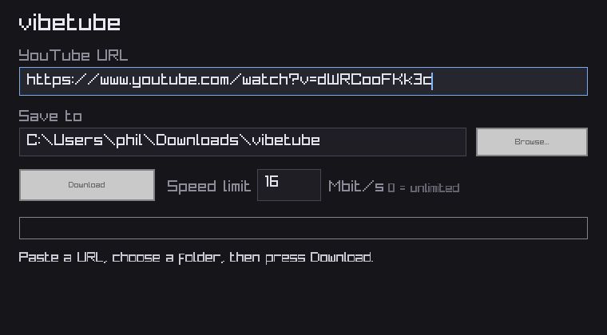

# vibetube v1.0

The first release. A small, fast, native Windows front end for `yt-dlp` that
turns a YouTube link into a 160 kbps MP3, with a speed cap so bulk downloads
don't draw attention.



## Highlights

- **Native Windows GUI in Odin** — raylib/raygui, a single ~1.2 MB executable.
  No Electron, no .NET, no Python runtime, no bundled browser.
- **Speed limiting** in Mbit/s (default **16**), passed straight through as
  `--limit-rate`. Correct unit handling: 16 Mbit/s becomes `2000000` bytes/s,
  not yt-dlp's `16M` mebibytes.
- **Deterministic filenames.** `<channel>_<title>_160k.mp3`, sanitised to pure
  ASCII with only `[A-Za-z0-9_-]`, accents transliterated, capped at 180 bytes.
- **No console window.** The app is a windowed binary and spawns its children
  with `CREATE_NO_WINDOW`.
- **Remembers your folder** in `%LOCALAPPDATA%\vibetube\config.ini`, written
  atomically.
- **Custom icon** across the title bar, taskbar, Explorer and pinned shortcuts.

## Requirements

| | |
|---|---|
| OS | Windows 10 / 11, x64 |
| Runtime | [`yt-dlp`](https://github.com/yt-dlp/yt-dlp) and [`ffmpeg`](https://ffmpeg.org/) on `PATH` |
| Build | [Odin](https://odin-lang.org/) with `vendor:raylib` |

Check the runtime deps first:

```bat
yt-dlp --version
ffmpeg -version
```

## Install

1. Download `vibetube.exe`.
2. Put it wherever you like — it is self-contained and writes nothing next to
   itself except on first run into `%LOCALAPPDATA%`.
3. Run it. Paste a URL, choose a folder, press **Download**.

No installer, no registry entries, no PATH changes.

## Download

| File | Size | SHA-256 |
|---|---|---|
| `vibetube.exe` | 1,261,568 bytes | `01D272C0A9577410BD8D5A81719679BF38884C97A6CD9B7F0BE71852C22A40BB` |

Verify with:

```powershell
Get-FileHash .\vibetube.exe -Algorithm SHA256
```

`vibetube.exe` is unsigned, so SmartScreen may warn on first run. It is built
locally from the sources in this repository; build it yourself with `build.bat`
if you would rather not trust a downloaded binary.

## Usage

- Paste a URL — `Ctrl+V` or type. `Enter` starts the download.
- **Browse…** picks the output folder; the path is remembered.
- **Speed limit** is in Mbit/s. `16` ≈ 2 MB/s. `0` disables the cap.
- `Tab` cycles fields, `Esc` drops focus. Closing the window aborts a running
  download and kills the child processes.

## Known limitations

- One video at a time; no playlists, no queue, no cancel button (close the
  window to abort).
- MP3 at 160 kbps only — no other formats or bitrates.
- Supported sites are whatever your `yt-dlp` supports.
- yt-dlp 2026 may warn that YouTube extraction prefers a JavaScript runtime
  (e.g. `deno` on `PATH`); some formats can be missing without one.
- Very fast bursts of typing can lose characters beyond 16 per frame, a raylib
  input-queue limit. Pasting is unaffected.

## Notes

- Config lives at `%LOCALAPPDATA%\vibetube\config.ini`; delete it to reset.
- Explorer may show a cached old icon until the shell icon cache refreshes.
- Built with Odin `dev-2026-11-nightly` and raylib `v6.2`.

## What's next

Not promised, but the obvious next steps are: a cancel button, a format/bitrate
picker, a download queue, and playlist support. See `ARCHITECTURE.md` for where
each of those plugs in.
